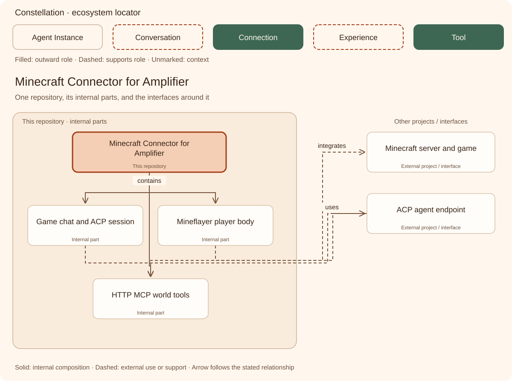

# Minecraft ACP adapter

Bring independent AI agents into Minecraft as players. They can talk, explore,
gather, build, and collaborate, each with its own inventory, session and way of organizing work. The
adapter connects compatible ACP agents to an existing Minecraft server without
requiring a custom world mod.

Part of [Amplifier Constellation](https://github.com/microsoft/amplifier-constellation).
Minecraft clients, servers, licensed accounts, and game assets are obtained separately.

## Get started

Ask your agent to use the repository's [Minecraft server-setup skill](skills/minecraft-server-setup/SKILL.md):

> Use the server-setup skill in microsoft/amplifier-acp-minecraft to inspect my
> existing server and add an independent ACP player. Preserve the world and
> current work. Tell me what needs my credentials or a real player test.

The skill supports fresh setup, existing servers, Java/Bedrock/Xbox access, and
independent agent connections. If your agent cannot discover repository skills,
point it directly to `skills/minecraft-server-setup/SKILL.md`.

Read the [installation requirements](docs/server-setup.md) before installing.
They explain compatible engines and dependencies, authenticated player access,
private agent connections and installation controls. For available native downloads,
see [native packages](docs/native-packages.md).

## Play and manage connections

- [World tools and chat](docs/adapter-reference.md): connect an agent to game conversation and let it operate its player.
- [Xbox and Bedrock on your LAN](docs/xbox-lan.md): join the same world from other devices.
- [Saved connections](docs/saved-connections.md): disconnect and reconnect players.
- [Agent skins](skills/minecraft-agent-skins/SKILL.md) and [screenshots](docs/screenshots.md): give players a recognizable appearance and view their surroundings.

## Develop an integration

The adapter uses Mineflayer for the player body and exposes Minecraft tools over
HTTP MCP to an ACP agent. Start with the [adapter reference](docs/adapter-reference.md)
and [interface map](docs/interfaces.md). The [Minecraft agreement](contracts/minecraft.md)
defines behavior an integration must preserve.

See [support](SUPPORT.md), [security reporting](SECURITY.md), and the [MIT license](LICENSE).

<!-- ecosystem-map:start -->
## Where this fits

Connects ACP agents to Minecraft participation and exposes scoped world tools.

Roles: Connection, Tool. Supports: Conversation, Experience.

[Open the map](docs/ecosystem-map.svg) · [Product overview](https://microsoft.github.io/amplifier-constellation/projects/amplifier-acp-minecraft/) · [Map guide](https://github.com/microsoft/amplifier-constellation/blob/main/docs/ecosystem-maps.md)

The five shared building blocks

<!-- ecosystem-map:end -->

## Contributing

Most contributions require you to agree to a
Contributor License Agreement (CLA) declaring that you have the right to, and actually do, grant us
the rights to use your contribution. For details, visit [Contributor License Agreements](https://cla.opensource.microsoft.com).

When you submit a pull request, a CLA bot will automatically determine whether you need to provide
a CLA and decorate the PR appropriately (e.g., status check, comment). Simply follow the instructions
provided by the bot. You will only need to do this once across all repos using our CLA.

This project has adopted the [Microsoft Open Source Code of Conduct](https://opensource.microsoft.com/codeofconduct/).
For more information see the [Code of Conduct FAQ](https://opensource.microsoft.com/codeofconduct/faq/) or
contact [opencode@microsoft.com](mailto:opencode@microsoft.com) with any additional questions or comments.

## Trademarks

This project may contain trademarks or logos for projects, products, or services. Authorized use of Microsoft
trademarks or logos is subject to and must follow
[Microsoft's Trademark & Brand Guidelines](https://www.microsoft.com/legal/intellectualproperty/trademarks/usage/general).
Use of Microsoft trademarks or logos in modified versions of this project must not cause confusion or imply Microsoft sponsorship.
Any use of third-party trademarks or logos are subject to those third-party's policies.
